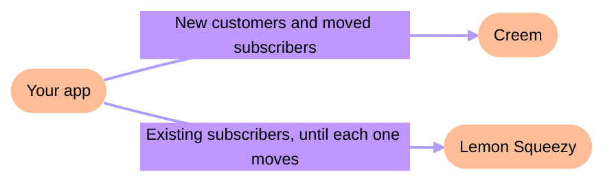

This is the step-by-step version of [Migrate from Lemon Squeezy](/getting-started/migrate/lemon-squeezy). It covers what moves through the API, what you set up in the dashboard, what can't move yet, and how to move existing subscribers without charging them twice. Use it to run the migration yourself, or to check what your agent or the [Creem CLI](/getting-started/migrate/lemon-squeezy#with-the-creem-cli) did. To let an agent do it, see [Migrate with a coding agent](#migrate-with-a-coding-agent). Lemon Squeezy stops processing payments, including subscription renewals, on March 31, 2027.

## How the migration works

During the migration, your app works with both providers. New customers buy on Creem, and existing subscribers keep renewing on Lemon Squeezy until each one moves. At any time, each subscription has exactly one system responsible for its next renewal.



<Steps>
  <Step title="Set up Creem in test mode">
    Create your account and run the whole migration with test keys first.
  </Step>
  <Step title="Take stock of your Lemon Squeezy store">
    Read everything through the Lemon Squeezy API, read-only, and export your records.
  </Step>
  <Step title="Rebuild your catalog">
    Products, files, license key settings and discount codes.
  </Step>
  <Step title="Import customers">Create each customer with a stable ID of your own.</Step>
  <Step title="Move new sales to Creem">
    Checkout, webhooks, license checks and the customer portal, then go live.
  </Step>
  <Step title="Move existing subscribers">
    One subscriber at a time, around their Lemon Squeezy renewal date.
  </Step>
  <Step title="Finish and clean up">
    Reconcile, unpublish your Lemon Squeezy products and revoke the API key.
  </Step>
</Steps>

## What moves

| Lemon Squeezy                                    | How it moves to Creem                                                                                                                                                          |
| ------------------------------------------------ | ------------------------------------------------------------------------------------------------------------------------------------------------------------------------------ |
| Products and variants                            | API. One Creem product per variant, because Creem has no variants                                                                                                              |
| Prices, billing cadence and trials               | API. Any cadence from daily to every 3 years; trials in whole days                                                                                                             |
| Pay what you want                                | API. The product price is the minimum, with an optional suggested price                                                                                                        |
| Descriptions                                     | API, after converting the HTML to Markdown                                                                                                                                     |
| Product images                                   | API by URL, then re-upload in the dashboard                                                                                                                                    |
| Files                                            | API: upload with [`POST /v1/files`](/api-reference/endpoint/create-file-upload), then add a `file` feature to the product. Or the [dashboard](/features/addons/file-downloads) |
| License key settings                             | API: a `licenseKey` feature on the product. See [license keys](/features/addons/licenses)                                                                                      |
| Discount codes                                   | API                                                                                                                                                                            |
| Customers                                        | API: email, name, country, your own ID and metadata                                                                                                                            |
| Affiliates                                       | Create the program in the dashboard, then [invite each affiliate by API](/guides/affiliate-program-via-api)                                                                    |
| Webhooks                                         | API, with new event names                                                                                                                                                      |
| Checkout links, custom checkouts and the overlay | Your code: Creem product links, the [checkout API](/features/checkout/checkout-api) or the [embedded checkout](/features/checkout/embedded-checkout)                           |

### Not possible yet

| Lemon Squeezy                                   | What to do instead                                                                                                                              |
| ----------------------------------------------- | ----------------------------------------------------------------------------------------------------------------------------------------------- |
| Saved cards                                     | Each subscriber enters a card once on Creem. See [Move existing subscribers](#6-move-existing-subscribers). Creem doesn't accept card transfers |
| PayPal                                          | Creem's checkout doesn't take PayPal. Lemon Squeezy can't move PayPal subscriptions to any provider, so those subscribers pay by card on Creem  |
| Order and payment history                       | Export it from Lemon Squeezy before March 31, 2027. Creem only shows orders it processed                                                        |
| Affiliate referral history                      | Lemon Squeezy affiliate links stop counting once sales move. Affiliates get new Creem links                                                     |
| Tiered (graduated or volume) and package prices | Creem prices are flat per unit. Contact support before you change your pricing                                                                  |
| Usage meters that bill the last reported value  | Creem meters count, sum, average, take the minimum or maximum, or count unique values                                                           |
| Prices from 0.01 to 0.99                        | A product is free or costs at least 1.00                                                                                                        |
| Setup fees                                      | A [paid trial](/features/trials) can charge a different first amount, but only one lower than the plan price                                    |
| Currencies other than USD and EUR               | Price your Creem products in USD or EUR                                                                                                         |
| Marketing consent                               | Keep it in the customer's `metadata` for your records. Creem doesn't use it for marketing                                                       |

## 1. Set up Creem in test mode

1. Create your Creem account and store. Your account is reviewed before you can take live payments; see [account reviews](/merchant-of-record/account-reviews/account-reviews).
2. Switch the dashboard to [test mode](/getting-started/test-mode) and create a test API key (`creem_test_…`). Test requests go to `https://test-api.creem.io`.
3. Run the whole migration in test mode first. Test and live mode don't share data, so you repeat the import with a live key at the end. Stable `external_id` values make that second run safe.

## 2. Take stock of your Lemon Squeezy store

Create an API key in Lemon Squeezy under **Settings → API**. Treat it as full access: use it only to read, keep it in an environment variable rather than in code or a chat, and delete it when the migration is done.

The Lemon Squeezy API follows JSON:API. Authenticate with `Authorization: Bearer`, request `page[size]=100` and follow `links.next` until it's empty:

```typescript inventory.ts
const LEMON_SQUEEZY_API = "https://api.lemonsqueezy.com/v1";

async function listAll(resource: string): Promise<unknown[]> {
  const items: unknown[] = [];
  let url: string | null = `${LEMON_SQUEEZY_API}/${resource}?page[size]=100`;
  while (url) {
    const response = await fetch(url, {
      headers: {
        Accept: "application/vnd.api+json",
        Authorization: `Bearer ${process.env.LEMONSQUEEZY_API_KEY}`,
      },
    });
    if (!response.ok) throw new Error(`${resource}: ${response.status}`);
    const body = await response.json();
    items.push(...body.data);
    url = body.links?.next ?? null;
  }
  return items;
}

const resources = [
  "stores",
  "products",
  "variants",
  "prices",
  "files",
  "discounts",
  "customers",
  "subscriptions",
  "subscription-items",
  "license-keys",
  "webhooks",
  "affiliates",
];
for (const resource of resources) {
  console.log(resource, (await listAll(resource)).length);
}
```

While you read, note what needs a decision:

- **Current prices.** Lemon Squeezy keeps every price a variant ever had and doesn't flag the current one. Take the newest price of the variant's own category (`subscription` or `one_time`).
- **Subscribers on older prices.** A Creem product has one current price, so plan a separate product for any older price you still honor.
- **Subscriptions** with their status and `renews_at` date, especially the ones renewing before March 31, 2027.
- **Variants with license keys or files**, and prices that are usage-based, tiered, use packages or carry a `setup_fee`.
- **Your store currency**, if it isn't USD or EUR.

Export your customers, orders and subscriptions as CSV for your records with Lemon Squeezy's [export guide](https://docs.lemonsqueezy.com/help/orders/exporting-orders).

## 3. Rebuild your catalog

### Products

Create one Creem product per Lemon Squeezy variant with [`POST /v1/products`](/api-reference/endpoint/create-product). Put the variant ID in `external_id`, so a second run finds what the first one created.

```bash
curl -X POST https://test-api.creem.io/v1/products \
  -H "x-api-key: $CREEM_API_KEY" \
  -H "Content-Type: application/json" \
  -d '{
    "name": "Pro",
    "description": "- 1 workspace\n- Unlimited projects\n- Email support",
    "price": 2000,
    "currency": "EUR",
    "billing_type": "recurring",
    "billing_period": "every-month",
    "tax_mode": "inclusive",
    "tax_category": "saas",
    "image_url": "https://example.com/pro.png",
    "external_id": "ls_variant_12345",
    "metadata": { "ls_product_id": "6789", "ls_variant_id": "12345" }
  }'
```

The full field mapping is in the [reference](#products-and-variants) at the end of this page. Four things need care:

- **Re-runs.** A create with an `external_id` already in use updates that product. Send `If-None-Match: *` to create only: Creem then answers `412` with the code `precondition_failed` and the product's id in `details.product_id`, so you skip it and keep any change made in Creem since.
- **Descriptions.** Lemon Squeezy stores descriptions as HTML; Creem's checkout renders Markdown and doesn't render HTML. Convert tag by tag: `<p>` to a paragraph, `<br>` to a line break, `<h1>`–`<h6>` to `#`–`######`, `<strong>`/`<b>` to `**bold**`, `<em>`/`<i>` to `_italic_`, `<s>`/`<del>` to `~~strike~~`, `<code>` to backticks, `<ul>`/`<ol>`/`<li>` to `-` and `1.` items (nested items indented), `<a>` to `[text](url)` and `<blockquote>` to `>`. Drop `` and report it. Then turn three or more one-line paragraphs in a row, a list written one `<p>` per line, into a bullet list. Compare each description before and after.
- **Images.** Creem stores the image URL and serves it through its image proxy; it doesn't copy the file. Re-upload each image in the dashboard so it keeps working after Lemon Squeezy's hosting goes away.
- **Tax category.** Lemon Squeezy's `eservice` has no exact match. It maps closest to `digital-goods-service`; confirm the category for each product.

### Files and license keys

Both go on the product as `features`, on create or with [`PATCH /v1/products/{id}`](/api-reference/endpoint/update-product):

- **License keys:** a `licenseKey` feature with the variant's activation limit and expiry. `activation_limit` is `license_activation_limit`, or `null` when unlimited; `expiry` is `{ "interval": "day" | "month" | "year", "interval_count": license_length_value }`, or `null` when keys never expire.
- **Files:** upload each one with [`POST /v1/files`](/api-reference/endpoint/create-file-upload) and [confirm it](/api-reference/endpoint/confirm-file-upload), then add a `file` feature with the file ids. You can also upload them under [file downloads](/features/addons/file-downloads) in the dashboard.

```json
{
  "features": [
    {
      "type": "licenseKey",
      "description": "License key",
      "license_key": {
        "activation_limit": 5,
        "expiry": { "interval": "year", "interval_count": 1 }
      }
    }
  ]
}
```

### Discount codes

Create each code with [`POST /v1/discounts`](/api-reference/endpoint/create-discount-code). The field mapping is in the [reference](#discount-codes). Mind these differences:

- A discount needs at least one product, in `applies_to_products` (Creem ids) or `applies_to_product_external_ids` (your `ls_variant_<id>` keys), at most 100. A Lemon Squeezy code that applies to everything must list every Creem product, and products you create later aren't covered.
- Give each discount an `external_id` such as `ls_discount_<id>` and create it with `If-None-Match: *`: on a re-run Creem answers `412` with the code `precondition_failed`, so you skip it. Edit a discount with [`PATCH /v1/discounts/{id}`](/api-reference/endpoint/update-discount-code).
- A code can exist only once. A second create with the same code fails with "The code has already been taken", so check with [search discounts](/api-reference/endpoint/search-discounts) before a re-run.
- Lemon Squeezy's start date and draft status have no equivalent. A repeating discount applies to subscriptions only.
- Creem counts redemptions from zero. If the Lemon Squeezy code had a limit, set `max_redemptions` to what's left.

## 4. Import customers

Create each customer with [`POST /v1/customers`](/api-reference/endpoint/create-customer). Importing customers creates no orders and sends them no email.

```bash
curl -X POST https://test-api.creem.io/v1/customers \
  -H "x-api-key: $CREEM_API_KEY" \
  -H "Content-Type: application/json" \
  -d '{
    "email": "jane@example.com",
    "name": "Jane Doe",
    "country": "NL",
    "external_id": "user_8f2c",
    "metadata": { "ls_customer_id": "1234567", "ls_marketing_status": "subscribed" }
  }'
```

- **`external_id`** is your application's own customer ID when you have one, or `ls_customer_<id>` otherwise. It's how you find the customer again.
- **`name`** is optional. When the Lemon Squeezy customer has none, leave it out. Don't make one up from the email: it prints on invoices and emails.
- **`country`** is the Lemon Squeezy `country`, a two-letter code. Tax on future renewals depends on it. Leave it out when it's empty (`null` is refused).
- **Marketing status** has no field. Keep it in `metadata`.
- Customers who later buy on Creem with the same email are matched to the customer you imported.

<Warning>
  Creating a customer with an email that already exists in your store returns that customer and
  replaces its name and `external_id`. Look the email up first with [`GET
  /v1/customers?email=`](/api-reference/endpoint/get-customer) and decide whether to skip or update
  it.
</Warning>

## 5. Move new sales to Creem

### Checkout

| Lemon Squeezy                          | Creem                                                                                                                                  |
| -------------------------------------- | -------------------------------------------------------------------------------------------------------------------------------------- |
| Buy links (`buy_now_url`)              | The product's `product_url`, for example `https://creem.io/payment/prod_xxxxx`. See [checkout links](/features/checkout/checkout-link) |
| Custom checkout (`POST /v1/checkouts`) | [`POST /v1/checkouts`](/api-reference/endpoint/create-checkout). Your custom data goes in `metadata` and comes back in webhooks        |
| Overlay checkout (Lemon.js)            | [Embedded checkout](/features/checkout/embedded-checkout)                                                                              |

```typescript checkout.ts
const response = await fetch("https://test-api.creem.io/v1/checkouts", {
  method: "POST",
  headers: { "x-api-key": process.env.CREEM_API_KEY!, "Content-Type": "application/json" },
  body: JSON.stringify({
    product_id: "prod_xxxxx",
    customer: { email: "jane@example.com" },
    success_url: "https://example.com/welcome",
    metadata: { app_user_id: "user_8f2c" },
  }),
});
const { checkout_url } = await response.json();
```

### Webhooks

Create an endpoint with [`POST /v1/webhooks`](/api-reference/endpoint/create-webhook) or in the dashboard, and map your handlers to Creem's [events](/code/webhooks). The full mapping is in the [reference](#webhook-events). The common ones:

| Lemon Squeezy                  | Creem                                             |
| ------------------------------ | ------------------------------------------------- |
| `order_created`                | `checkout.completed`                              |
| `subscription_created`         | `subscription.active`, or `subscription.trialing` |
| `subscription_payment_success` | `subscription.paid`                               |
| `subscription_cancelled`       | `subscription.scheduled_cancel`                   |
| `subscription_expired`         | `subscription.canceled`                           |
| `subscription_payment_failed`  | `subscription.past_due`                           |

Both providers sign the raw request body with HMAC-SHA256. Lemon Squeezy sends the hex digest in `X-Signature`; Creem sends it in `creem-signature`. Creem makes up to five delivery attempts for each event, so make your handlers idempotent on the event `id`.

### License keys

Creem's license endpoints need your API key, so call them from your backend, never from the app you ship. Lemon Squeezy's License API needs no key, so apps often call it directly; route those calls through your server.

| Lemon Squeezy License API                                           | Creem                                                                                                     |
| ------------------------------------------------------------------- | --------------------------------------------------------------------------------------------------------- |
| `POST /v1/licenses/activate`: `license_key`, `instance_name`        | [`POST /v1/licenses/activate`](/api-reference/endpoint/activate-license): `key`, `instance_name`          |
| `POST /v1/licenses/validate`: `license_key`, optional `instance_id` | [`POST /v1/licenses/validate`](/api-reference/endpoint/validate-license): `key`, `instance_id` (required) |
| `POST /v1/licenses/deactivate`: `license_key`, `instance_id`        | [`POST /v1/licenses/deactivate`](/api-reference/endpoint/deactivate-license): `key`, `instance_id`        |

During the migration, your app accepts both: Creem keys for purchases on Creem, Lemon Squeezy keys for customers who haven't moved. Lemon Squeezy hasn't said whether its License API keeps answering after March 31, 2027, so plan for it to stop.

### Customer portal

Replace links to Lemon Squeezy's customer portal with Creem's [customer portal](/features/customer-portal). [`POST /v1/customers/billing`](/api-reference/endpoint/create-customer-billing) returns a signed-in `customer_portal_link` for a customer; customers can also sign in with their email.

If you sell usage-based plans, send each subscriber's usage to Lemon Squeezy until they move, and to Creem [usage-based billing](/features/usage-based-billing) from then on.

### Go live

Once your account is approved, create a live API key, run the catalog and customer import again with it, and swap the links and API calls on your site. New customers now buy on Creem. Leave your Lemon Squeezy store running for the subscribers who haven't moved yet.

## 6. Move existing subscribers

<Note>
  [Your agent](#migrate-with-a-coding-agent) imports each active subscription into the sandbox,
  paused, with its Lemon Squeezy renewal date. Switching those subscribers on Creem, with their card
  entered once and the first charge on that date, comes next. Until then, move a subscriber with one
  checkout, as below.
</Note>

Move subscribers one at a time, close to each one's Lemon Squeezy renewal date (`renews_at`), so nobody pays twice for the same period.

<Steps>
  <Step title="Create a checkout for the subscriber">
    Use the product that matches their plan, the customer you imported, and the Lemon Squeezy IDs in `metadata`. Add a `discount_code` if you offer one, for example to cover days they already paid for.

    ```json
    {
      "product_id": "prod_xxxxx",
      "customer": { "id": "cust_xxxxx" },
      "discount_code": "MOVED10",
      "metadata": { "ls_subscription_id": "123456", "ls_customer_id": "1234567" }
    }
    ```

  </Step>
  <Step title="Send them the link">
    Creem doesn't send migration emails, so send your own: that Lemon Squeezy is shutting down, that Creem is now the seller on their statement and invoices, the link, and the date their Lemon Squeezy subscription would renew.
  </Step>
  <Step title="Cancel on Lemon Squeezy only after Creem is active">
    Creem copies the checkout's `metadata` to the subscription. When `subscription.active` arrives with your `ls_subscription_id` in it, cancel that subscription with the Lemon Squeezy API (`DELETE /v1/subscriptions/{id}`). It stays active until its paid period ends and doesn't renew. Never cancel on Lemon Squeezy first.
  </Step>
  <Step title="Track who has moved">
    Store the Lemon Squeezy and Creem subscription IDs side by side in your database and remind the subscribers who haven't moved. Anyone still on Lemon Squeezy on March 31, 2027 stops renewing there.
  </Step>
</Steps>

<Warning>
  Before you cancel real subscriptions, test a cancellation in Lemon Squeezy's test mode: check
  whether Lemon Squeezy emails the customer, and make sure your own `subscription_cancelled` handler
  doesn't revoke access for a subscriber who just moved.
</Warning>

## 7. Finish and clean up

- **Reconcile.** Compare products, discount codes, customers and subscriptions in both systems, and confirm that each subscription renews in exactly one place.
- **Unpublish your Lemon Squeezy products** in the Lemon Squeezy dashboard so nobody buys there; the Lemon Squeezy API can't change products.
- **Re-upload product images** in the Creem dashboard if you haven't yet.
- **Keep your Lemon Squeezy webhook handlers** until the last Lemon Squeezy subscription has ended, then remove the Lemon Squeezy code paths.
- **Delete your Lemon Squeezy API key.**

## Migrate with a coding agent

Creem publishes the migration as an agent skill. Give your agent one prompt:

```text
Read https://creem.io/SKILL.md and move my Lemon Squeezy store to Creem.
My Lemon Squeezy API key is in LEMONSQUEEZY_API_KEY. Never print, log or commit it.
```

- **[`SKILL.md`](https://creem.io/SKILL.md)** is Creem's main agent skill, and the one to use in most cases. It routes your agent to the migration guide and teaches it the rest of Creem (checkout, webhooks, license checks, the CLI), which it needs for [step 5](#5-move-new-sales-to-creem) in your code.
- **[`MIGRATE-LEMONSQUEEZY.md`](https://creem.io/MIGRATE-LEMONSQUEEZY.md)** holds the migration alone. Use it directly when your agent only does the migration and doesn't touch your app.

Your agent creates a Creem sandbox, reads your Lemon Squeezy store read-only, shows you a plan and waits for your yes. Then it brings over products, discounts, customers with their country, active and trialing subscriptions (paused, on their Lemon Squeezy renewal date) and license keys with the same codes. It charges, emails and cancels nothing, and hands you a claim link for [creem.io/claim](https://creem.io/claim) and a report of what didn't move. Running it again is safe.

## Use the Creem CLI

For the catalog alone, the Creem CLI copies products and discount codes in one command. See [With the Creem CLI](/getting-started/migrate/lemon-squeezy#with-the-creem-cli) for the commands and the fields to fix after a run. Prefer help? Email support@creem.io and our team can run the migration with you.

## Reference

### API basics

|             | Lemon Squeezy                          | Creem                                                             |
| ----------- | -------------------------------------- | ----------------------------------------------------------------- |
| Base URL    | `https://api.lemonsqueezy.com/v1`      | `https://api.creem.io` (live), `https://test-api.creem.io` (test) |
| Auth header | `Authorization: Bearer <key>`          | `x-api-key: <key>`                                                |
| Format      | JSON:API (`data.attributes`)           | Plain JSON                                                        |
| Pagination  | `page[size]`, then follow `links.next` | `page_number`, `page_size`                                        |
| Amounts     | Cents                                  | Cents                                                             |
| Test mode   | Separate test-mode keys and data       | Separate test keys (`creem_test_…`) and data                      |

### Objects

| Lemon Squeezy       | Creem                                                   |
| ------------------- | ------------------------------------------------------- |
| Product and variant | Product, one per variant                                |
| Price               | The product's price                                     |
| File                | File download on the product (dashboard)                |
| Discount            | Discount code                                           |
| Customer            | Customer                                                |
| Order               | Not imported. Creem creates orders for its own payments |
| Subscription        | Imported paused by the agent skill, or a checkout       |
| License key         | Imported with the same code by the agent skill          |
| Affiliate           | Affiliate, after accepting an invite                    |
| Webhook             | Webhook endpoint                                        |
| Checkout            | Checkout session                                        |
| Usage record        | Usage event                                             |

### Products and variants

| Lemon Squeezy                                                      | Creem product field                                                | Notes                                                                                                                                                                                                                   |
| ------------------------------------------------------------------ | ------------------------------------------------------------------ | ----------------------------------------------------------------------------------------------------------------------------------------------------------------------------------------------------------------------- |
| Product name, plus the variant name when a product has several     | `name`                                                             |                                                                                                                                                                                                                         |
| `description` (HTML)                                               | `description` (Markdown)                                           | Convert as described in [Rebuild your catalog](#3-rebuild-your-catalog)                                                                                                                                                 |
| Current price `unit_price`                                         | `price`                                                            | Cents. 0, or at least 100                                                                                                                                                                                               |
| Store currency                                                     | `currency`                                                         | `USD` or `EUR`                                                                                                                                                                                                          |
| `is_subscription`                                                  | `billing_type`                                                     | `recurring` or `onetime`                                                                                                                                                                                                |
| `interval`, `interval_count`                                       | `billing_period`, `recurring_interval`, `recurring_interval_count` | Presets: `every-day`, `every-month`, `every-three-months`, `every-six-months`, `every-year`. Anything else: `custom` with a `recurring_interval` of `day`, `week`, `month` or `year` and a count up to 365, 52, 24 or 3 |
| `has_free_trial`, `trial_interval`, `trial_interval_count`         | `trial_period_days`                                                | Whole days. Convert weeks, months and years to days                                                                                                                                                                     |
| `pay_what_you_want`, `min_price`, `suggested_price`                | `pay_what_you_want`, `price`, `suggested_price`                    | The Creem `price` is the minimum                                                                                                                                                                                        |
| Price `tax_code`: `saas`, `eservice`, `ebook`                      | `tax_category`: `saas`, `digital-goods-service`, `ebooks`          | Confirm `eservice` products                                                                                                                                                                                             |
| Tax-inclusive prices                                               | `tax_mode`                                                         | `inclusive` or `exclusive`                                                                                                                                                                                              |
| `large_thumb_url`                                                  | `image_url`                                                        | Re-upload the image in the dashboard                                                                                                                                                                                    |
| `has_license_keys`, `license_activation_limit`, `license_length_*` | A `licenseKey` feature                                             |                                                                                                                                                                                                                         |
| Variant ID                                                         | `external_id`                                                      | Unique per store                                                                                                                                                                                                        |
| Product, variant and price IDs                                     | `metadata`                                                         | For your own reconciliation                                                                                                                                                                                             |
| `buy_now_url`                                                      | `product_url`                                                      | Returned when the product is created                                                                                                                                                                                    |

### Discount codes

| Lemon Squeezy                               | Creem discount field                                         |
| ------------------------------------------- | ------------------------------------------------------------ |
| `name`                                      | `name`                                                       |
| `code`                                      | `code`                                                       |
| `amount_type`: `percent` or `fixed`         | `type`: `percentage` or `fixed`, with `currency` for `fixed` |
| `amount`                                    | `percentage`, or `amount` in cents                           |
| `duration`: `once`, `forever`, `repeating`  | `duration`: `once`, `forever`, `repeating`                   |
| `duration_in_months`                        | `duration_in_months`                                         |
| `is_limited_redemptions`, `max_redemptions` | `max_redemptions`, minus the redemptions already used        |
| `expires_at`                                | `expiry_date`                                                |
| `is_limited_to_products` and its variants   | `applies_to_products`, required                              |
| `starts_at`, draft status                   | No equivalent                                                |

### Customers

| Lemon Squeezy                        | Creem customer field                          |
| ------------------------------------ | --------------------------------------------- |
| `email`                              | `email`                                       |
| `name`                               | `name`, optional                              |
| Customer ID                          | `external_id` (or your own ID) and `metadata` |
| `country`                            | `country`                                     |
| `region`, `city`                     | `metadata` only                               |
| Marketing `status` (`subscribed`, …) | `metadata` only                               |

### Subscription statuses

| Lemon Squeezy                        | Creem              |
| ------------------------------------ | ------------------ |
| `on_trial`                           | `trialing`         |
| `active`                             | `active`           |
| `paused`                             | `paused`           |
| `past_due`                           | `past_due`         |
| `unpaid`                             | `unpaid`           |
| `cancelled` (active until `ends_at`) | `scheduled_cancel` |
| `expired`                            | `canceled`         |

Creem's `expired` status isn't Lemon Squeezy's: it means the period ended without a successful payment while retries can still succeed. `canceled` is final.

### Webhook events

| Lemon Squeezy                                                                           | Creem                                                                    |
| --------------------------------------------------------------------------------------- | ------------------------------------------------------------------------ |
| `order_created`                                                                         | `checkout.completed`. License keys arrive in its `license_keys`          |
| `subscription_created`                                                                  | `subscription.active`, or `subscription.trialing` for a trial            |
| `subscription_payment_success`                                                          | `subscription.paid`, for the first payment and every renewal             |
| `subscription_updated`                                                                  | `subscription.update`. A status change sends that status's event instead |
| `subscription_cancelled`                                                                | `subscription.scheduled_cancel`; `subscription.canceled` when it ends    |
| `subscription_resumed`, `subscription_unpaused`                                         | `subscription.active`                                                    |
| `subscription_paused`                                                                   | `subscription.paused`                                                    |
| `subscription_expired`                                                                  | `subscription.canceled`                                                  |
| `subscription_payment_failed`                                                           | `subscription.past_due`. Creem retries the payment                       |
| `subscription_payment_recovered`                                                        | `subscription.paid`, and `subscription.active` when the status returns   |
| `order_refunded`, `subscription_payment_refunded`                                       | `refund.created`                                                         |
| `license_key_created`, `license_key_updated`, `customer_updated`, `affiliate_activated` | No Creem webhook                                                         |
| No equivalent                                                                           | `dispute.created`                                                        |

### Checkout fields

| Lemon Squeezy custom checkout               | Creem checkout                                 |
| ------------------------------------------- | ---------------------------------------------- |
| `checkout_data.email`, `checkout_data.name` | `customer.email`, or `customer.id`             |
| `checkout_data.discount_code`               | `discount_code`                                |
| `checkout_data.custom`                      | `metadata`, returned in webhooks               |
| Quantity                                    | `units`                                        |
| `product_options.redirect_url`              | `success_url`                                  |
| `custom_price`                              | `custom_price`, for one-time products only     |
| `test_mode`                                 | A test API key and `https://test-api.creem.io` |
