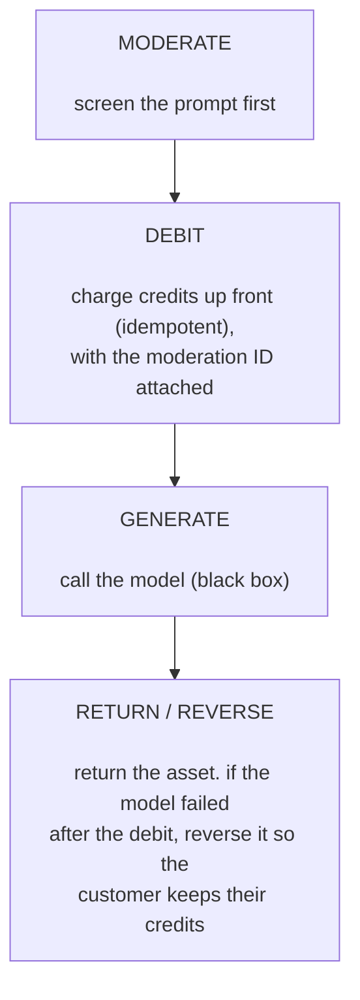

<Note>
  This guide walks through a full sample app. For the short, step by step version of the same
  integration, see the [Gen AI Technical Integration
  Guide](/merchant-of-record/account-reviews/gen-ai-technical-integration-guide). [Gen AI
  Requirements](/merchant-of-record/account-reviews/gen-ai-requirements) explains why it is
  required.
</Note>

Charging for AI generations in a way that meets [MoR or PSP guidelines](/merchant-of-record/account-reviews/ai-wrapper-compliance) is hard with unmoderated prompts, failed generations and incorrect customer credits deduction. For e.g., Adobe Firefly users [report failed video jobs that produce nothing yet still deduct credits](https://community.adobe.com/t5/adobe-firefly-bugs/credits-are-being-deducted-even-when-video-generation-fails/idi-p/15659871), with one person losing 680 credits across 17 error-filled attempts. Users are bound to get frustrated if charges are made before the provider is sure that the model worked, or before the prompt has been screened. The fix is in the order of generation steps: moderate the prompt, charge the credits with the moderation result attached, generate, and refund automatically if the model fails.

In this guide you build [Aperture](https://github.com/armitage-labs/creem/tree/main/packages/examples/safe-metered-ai-generator), a reference image and video generator that uses Creem for billing and moderation. Each user gets a `generation` credit wallet in the [Customer Credits API](/features/customer-credits/introduction#quick-start) when they sign up, Creem adds purchased credits to it, and every prompt is validated through the [Moderation API](/features/moderation). Each debit carries the ID of the moderation result that cleared its prompt.

## Demo

Aperture implements the following four-step order for every generation:



Try it at [aperture-creem.vercel.app](https://aperture-creem.vercel.app). The tabs below show the possible prompt moderation results in the application:

<Tabs>
<Tab title="allow">
An ordinary prompt, screened by the live Moderation API and verified to pass. It clears moderation, debits 5 credits, renders a poster into the gallery, and the wallet drops by 5.


</Tab>
<Tab title="deny">
An ordinary prompt the live API rejects on policy grounds. It is blocked before any debit, the wallet does not change, and the attempt is recorded as `rejected`.


</Tab>
<Tab title="flag">
A prompt containing `#force-moderation-flag`, which forces the flag branch so you can see the app block a flag.


</Tab>
<Tab title="error">
A prompt containing `#force-moderation-error`, which forces the moderation call to fail so you can see the fail-closed path. Worst case in production, it blocks a request that would otherwise be screened normally.


</Tab>
</Tabs>

## Prerequisites

- Node.js 22 or newer, and pnpm 11
- A [Creem](https://creem.io) account
- A [Neon](https://console.neon.tech) account

## Clone the project

Since there's a lot to cover in this application, the better way is to clone the project, install its dependencies, and then learn the core parts around moderation and billing with Creem.

Run the following commands to clone and install the project:

```bash
pnpm dlx degit armitage-labs/creem/packages/examples/safe-metered-ai-generator safe-metered-ai-generator
cd safe-metered-ai-generator
pnpm install
```

It installs the following important dependencies:

- `creem` is the official SDK (version 1.14.0 or later) through which the Customer Credits and Moderation are managed.
- `@creem_io/better-auth` is the Better Auth plugin of Creem.
- `better-auth` handles email and password sign-in.
- `@neondatabase/serverless` to query Postgres in serverless functions over HTTP requests.

Then, copy the environment variable file with the following command:

```bash
cp .env.example .env.local
```

Now, let's provision a serverless Postgres as the database.

## Provision a Serverless Postgres

To set up a serverless Postgres, go to the [Neon console](https://console.neon.tech/app/projects) and create a new project. Once your project is created, you will receive a connection string that you can use to connect to your Neon database. The connection string will look like this:

```bash shouldWrap
postgresql://<user>:<password>@<endpoint_hostname>.neon.tech:<port>/<dbname>?sslmode=require&channel_binding=require
```

Use this connection string as an environment variable designated as `DATABASE_URL` in the `.env.local` file.

## Configure Creem credentials

<Steps>
<Step title="Copy your API key">
Grab your API key from the [Developers section](https://creem.io/dashboard/developers) of the dashboard and set it as `CREEM_API_KEY`. The app picks test vs production mode from the key prefix (`creem_test_` is test mode).
</Step>
<Step title="Create the three credit packs">
Each pack (Starter, Pro, and Studio) maps to a one-time Creem product with an **AI generation credits** feature. The feature holds the number of credits the pack grants: when a user pays, Creem adds them to that user's generation wallet. With `CREEM_API_KEY` set, run the setup script to create all three at once:

```bash
pnpm products:setup
```

It prints the three `CREEM_PRODUCT_*` lines to paste into `.env.local`. Re-running in the same mode returns the existing products instead of creating duplicates.

Prefer the dashboard? In the [products tab](https://creem.io/dashboard/products), create one product per pack. In **Delivery**, click **Add**, choose **New AI generation credits**, and set the credit amount (200, 1000 and 3000). Then copy each product ID (it starts with `prod_`) into `CREEM_PRODUCT_STARTER`, `CREEM_PRODUCT_PRO`, and `CREEM_PRODUCT_STUDIO`.

</Step>
<Step title="Generate a Better Auth secret">
[Better Auth](https://better-auth.com/) signs sessions with `BETTER_AUTH_SECRET`. Generate a random value with the following and update in the `.env.local` file:

```bash
openssl rand -base64 32
```

</Step>
</Steps>

Once that's done, execute the following command in your terminal to see the application in action on [localhost:3000](http://localhost:3000):

```bash
pnpm dev
```

Press `CTRL-C` to stop the server and now let's move to understanding the codebase.

## Initialize the Creem SDK client

Every call in the app reuses a single SDK instance from [`src/lib/creem/client.ts`](https://github.com/armitage-labs/creem/blob/main/packages/examples/safe-metered-ai-generator/src/lib/creem/client.ts):

```ts
import { Creem } from "creem";
import { env } from "../env";

export const creemClient = new Creem({
  apiKey: env.creemApiKey,
  server: env.isTestMode ? "test" : "prod",
});
```

The SDK picks the host from the `server` option (`api.creem.io` for production, `test-api.creem.io` for test) and adds the `x-api-key` header to every request. The app sets `server` by checking whether the API key starts with `creem_test_`.

## Set up the database schema

Creem is the source of truth for balances, so the schema in [`db/schema.sql`](https://github.com/armitage-labs/creem/blob/main/packages/examples/safe-metered-ai-generator/db/schema.sql) only has the Better Auth tables and a few application tables. Two of them related to billing are as follows:

```sql
-- maps one app user to one Creem credit wallet.
-- account_id is a Creem cca_… id; provider is always 'creem'.
CREATE TABLE IF NOT EXISTS "credit_account" (
  "user_id"           TEXT PRIMARY KEY REFERENCES "user"("id") ON DELETE CASCADE,
  "creem_customer_id" TEXT NOT NULL,
  "account_id"        TEXT NOT NULL,
  "provider"          TEXT NOT NULL DEFAULT 'creem',
  "unit_label"        TEXT NOT NULL DEFAULT 'credits',
  "status"            TEXT NOT NULL DEFAULT 'active',
  -- ...
);

-- a denormalised mirror of every wallet movement, for fast history and audit.
CREATE TABLE IF NOT EXISTS "credit_ledger_cache" (
  "id"             TEXT PRIMARY KEY,
  "user_id"        TEXT NOT NULL REFERENCES "user"("id") ON DELETE CASCADE,
  "account_id"     TEXT NOT NULL,
  "transaction_id" TEXT,
  "side"           TEXT NOT NULL,   -- 'credit' | 'debit'
  "amount"         NUMERIC NOT NULL,
  "reference"      TEXT,
  "kind"           TEXT,            -- pack_purchase | generation | refund | adjustment
  -- ...
);
```

- `credit_account` is a lookup table. It does not store a balance. It only remembers which Creem customer (`cust_…`) and generation wallet (`cca_…`) belong to which user, so a request can ask Creem for the live balance of the customer.
- `credit_ledger_cache` is a read model. It mirrors every credit and debit. It enables fetching the transaction history page without a round trip to Creem on every page load. It also keeps an audit trail after an account is closed.

Now, apply the schema in your database with the following command:

```bash
pnpm db:migrate
```

## Screen the prompt before generation

Creem [requires moderation on AI generation products](/features/moderation#why-moderation-matters), so the wrapper in [`src/lib/creem/moderation.ts`](https://github.com/armitage-labs/creem/blob/main/packages/examples/safe-metered-ai-generator/src/lib/creem/moderation.ts) follows three rules:

1. Screen the prompt before anything else.
2. Block on both `deny` and `flag`.
3. If the call errors or times out, block. Never generate on an unknown answer.
4. Keep the `id` of the result. The debit needs it.

```ts
export async function screenPrompt(prompt: string, externalId?: string): Promise<ModerationResult> {
  try {
    const data = await creemClient.moderation.screenPrompt(
      { prompt, externalId },
      { timeoutMs: 5000 }, // a slow moderator must not hold the request open forever
    );
    const decision = data.decision;

    if (decision === "allow") {
      return { decision: "allow", allowed: true, id: data.id, raw: data };
    }
    if (decision === "deny" || decision === "flag") {
      return blocked(decision, data);
    }
    // Unknown or absent decision. Do not assume safe. Fail closed.
    return blocked("error", data);
  } catch {
    // API error, network error, or timeout. Fail closed.
    return blocked("error");
  }
}
```

`allowed` is `true` only on an explicit `allow`. Every other branch, including the empty `catch`, returns `false`. So the request is blocked on any error, timeout, or an unknown response code. This ensures that generations are always moderated. On `allow`, the result also carries the moderation `id`, which the route passes to the debit.

## Implement the wallet layer

Every balance change goes through one module, [`src/lib/wallet.ts`](https://github.com/armitage-labs/creem/blob/main/packages/examples/safe-metered-ai-generator/src/lib/wallet.ts) and is used by the routes and the sign-up hook. It calls the Creem API on every generation, and then it mirrors the actions into Postgres for history and auditing.

The wallet layer is comprised of two files:

- [`src/lib/wallet.ts`](https://github.com/armitage-labs/creem/blob/main/packages/examples/safe-metered-ai-generator/src/lib/wallet.ts): exposes wallet controls, such as `ensureWalletForUser`, `debitForGeneration`, `refundDebit`, `getBalance`, `listHistory`, and the account controls (`freeze`, `unfreeze`, `close`).
- [`src/lib/creem/credits-creem.ts`](https://github.com/armitage-labs/creem/blob/main/packages/examples/safe-metered-ai-generator/src/lib/creem/credits-creem.ts): adapter over `creemClient.customerCredits.*`. It makes the Creem calls and maps the camelCase responses onto the application's snake_case types.

### Create the wallet at sign-up

Every user gets a Creem customer and a credit wallet as soon as they sign up. The wallet has to be named `generation`: that name makes it the AI generation wallet, so purchased credits land in it and every debit from it requires a moderation result.

```ts
export const GENERATION_WALLET = "generation";

export async function ensureWalletForUser(user: { id: string; email: string; name: string }) {
  const existing = await getAccountForUser(user.id);
  if (existing) return existing;
  // ...inside a per-user advisory lock:
  const customer = await findOrCreateCustomer(user); // externalId = your user id
  const account =
    (await credits.findAccount(customer.id, GENERATION_WALLET)) ??
    (await credits.createAccount({
      customerId: customer.id,
      name: GENERATION_WALLET,
      unitLabel: "credits",
      initialBalance: String(WELCOME_CREDITS), // optional free credits
    }));
  // ...store customer.id and account.id in credit_account
}
```

In the code above:

- `findOrCreateCustomer` in [`src/lib/creem/customers.ts`](https://github.com/armitage-labs/creem/blob/main/packages/examples/safe-metered-ai-generator/src/lib/creem/customers.ts) looks the customer up by email and creates it with `externalId` set to the app's user id if it does not exist.
- `initialBalance` gives new users 20 free credits. Free credits work like paid ones: spending them still requires a moderation result.
- Creating a wallet has no idempotency key, so the function serializes per-user creation behind a transaction-scoped advisory lock (`pg_advisory_xact_lock`) and re-checks the table inside the lock. Exactly one wallet is created per user.

The function is called from a Better Auth hook in [`src/lib/auth.ts`](https://github.com/armitage-labs/creem/blob/main/packages/examples/safe-metered-ai-generator/src/lib/auth.ts) that runs after a user is created:

```ts
databaseHooks: {
  user: {
    create: {
      after: async (user) => {
        // A Creem outage must not block sign-up: the routes call
        // ensureWalletForUser again and create the wallet then.
        await ensureWalletForUser(user).catch((err) => console.error(err));
      },
    },
  },
},
```

### Debit with the moderation ID

A generation is paid for with a debit from the generation wallet. It carries two things besides the amount: an idempotency key and the moderation ID.

```ts
export async function debitForGeneration(args: {
  userId: string;
  accountId: string;
  amount: number;
  reference: string;
  idempotencyKey: string;
  moderationId: string;
}): Promise<Transaction> {
  const result = await credits.debit(args.accountId, {
    amount: String(args.amount),
    reference: args.reference,
    idempotencyKey: args.idempotencyKey,
    moderationId: args.moderationId,
  });
  await cacheMovement({
    /* mirror into credit_ledger_cache */
  });
  return result;
}
```

- **The idempotency key.** Retries happen for ordinary reasons: a user double-clicks, or a network blip makes a client resend a request that already succeeded. An [idempotency key](/features/customer-credits/transactions#what-is-an-idempotency_key) means Creem treats the retry as the same operation and does not change the balance a second time.
- **The moderation ID.** Creem refuses a debit from the generation wallet unless it carries the ID of an `allow` result from your store that is at most 24 hours old and has not paid for another debit.

`cacheMovement` mirrors the same entry into `credit_ledger_cache` so the history page can show its `reference`.

The adapter turns Creem's error codes into typed errors for the route:

```ts
async debit(accountId, input) {
  try {
    const txn = await creemClient.customerCredits.debitAccount(accountId, input)
    return toTransaction(txn)
  } catch (err) {
    const code = errorCode(err) // Creem's error code, read from the error body
    if (code === 'insufficient_balance') throw new InsufficientBalanceError()
    if (code?.startsWith('moderation_')) throw new ModerationDebitError(code)
    throw err
  }
}
```

In the code above, `insufficient_balance` lets the application show the user a clean "you need N credits" (instead of a raw API error). A `moderation_*` code, such as `moderation_id_required` or `moderation_result_already_used`, means Creem refused the debit because of its moderation result. In both cases nothing was debited.

### Read current and point-in-time balances

The balance read passes an optional `at` timestamp to Creem:

```ts
async getBalance(accountId: string, at?: string): Promise<Balance> {
  const balance = await creemClient.customerCredits.getAccountBalance(accountId, at)
  return toBalance(balance)
}
```

In the code above:

- With no `at`, you get the current balance.
- With an ISO timestamp, you get the balance at that moment. This is helpful for a support question like "how many credits did this customer have on the 3rd August".

### Reverse a debit

Creem has a reversal operation enabling you to skip manual re-credits. When a generation fails after you've charged, you can reverse the exact debit transaction:

```ts
export async function refundDebit(args: {
  userId: string;
  accountId: string;
  transactionId: string;
  amount: number;
  reference: string;
}): Promise<Transaction> {
  const result = await credits.reverse(args.accountId, args.transactionId);
  await cacheMovement({ ...args, side: "credit", kind: "refund" });
  return result;
}
```

A reversal adds a compensating entry, which shows both the charge and the refund in history. This is helpful for customer support when you need to see the usage history to answer queries.

## Implement the generation route

When a generation is requested via [`src/app/api/generate/route.ts`](https://github.com/armitage-labs/creem/blob/main/packages/examples/safe-metered-ai-generator/src/app/api/generate/route.ts), it goes through the four steps shared earlier in-order. In this section, we cover each step in detail. Let's start with how requests are validated.

### Validate the request

The route uses a [withUser](https://github.com/armitage-labs/creem/blob/main/packages/examples/safe-metered-ai-generator/src/lib/session.ts#L37) re-usable function to allow only authenticated user to request generations. It parses the body with [Zod](https://zod.dev/), sets the cost from the media type (an image is 5 credits, a video is 40), and accepts an optional client-supplied idempotency key so a retry from the browser doesn't double-charge or double-generate.

It also validates the optional reference image. The `imageDataUrl` has to be a base64 image data URL, and the route rejects anything over 2.5 MB (as a demonstration of enforcing limits).

```ts
if (imageDataUrl) {
  const bytes = dataUrlByteLength(imageDataUrl);
  if (bytes === null)
    return NextResponse.json(
      { error: "invalid_image", message: "Reference image must be a base64 data URL." },
      { status: 400 },
    );
  if (bytes > MAX_IMAGE_BYTES)
    return NextResponse.json(
      { error: "image_too_large", message: `Reference image must be under ${MAX_IMAGE_LABEL}.` },
      { status: 413 },
    );
}
```

### Replay a completed request

The route then checks whether this idempotency key already produced a finished generation. If it did, it returns that result and runs nothing else.

```ts
// Idempotency: if this key already produced a completed generation, replay it.
const prior = await queryOne(
  `SELECT id, status, result_url FROM generation
   WHERE user_id=$1 AND idempotency_key=$2 ORDER BY created_at DESC LIMIT 1`,
  [user.id, idempotencyKey],
);
if (prior && prior.status === "completed") {
  return NextResponse.json({
    id: prior.id,
    status: "completed",
    url: prior.result_url,
    replayed: true,
  });
}
```

Before consuming credits, it loads the user's wallet with `ensureWalletForUser` and checks that it is `active`. A frozen or closed account is turned away with a clear status. Then the following four steps run:

### Step 1: moderate

If the prompt doesn't clear, the route records a `rejected` generation and returns. Nothing has been charged from the user in this case.

```ts
const moderation = await screenPrompt(prompt, `user_${user.id}:gen_${genId}`);
if (!moderation.allowed || !moderation.id) {
  await recordGeneration({
    /* status: 'rejected', decision: moderation.decision */
  });
  return NextResponse.json(
    { id: genId, status: "rejected", decision: moderation.decision, message: moderation.reason },
    { status: 400 },
  );
}
```

### Step 2: debit

The user is then charged (before the model runs). A separate idempotency key derived from the request key keeps the debit itself safe to retry, and `moderationId` links the debit to the result from step 1. One moderation ID pays for one debit. An insufficient balance is caught as a 402, and a debit Creem refuses because of its moderation result is returned as a blocked prompt. In both cases nothing was charged, and the generation is recorded so the attempt is not lost.

```ts
let debitTxnId: string;
try {
  const txn = await debitForGeneration({
    userId: user.id,
    accountId: account.accountId,
    amount: cost,
    reference: `gen:${genId}`,
    idempotencyKey: `debit_${idempotencyKey}`,
    // Proof the prompt was screened and allowed. One id pays for one debit.
    moderationId: moderation.id,
  });
  debitTxnId = txn.id;
} catch (err) {
  if (err instanceof InsufficientBalanceError) {
    await recordGeneration({
      /* status: 'insufficient_credits' */
    });
    return NextResponse.json(
      {
        status: "insufficient_credits",
        message: `You need ${cost} credits for this ${mediaType}.`,
      },
      { status: 402 },
    );
  }
  if (err instanceof ModerationDebitError) {
    // Creem refused the debit because of its moderation result (expired,
    // already used, ...). Nothing was charged, so treat it as a blocked prompt.
    await recordGeneration({
      /* status: 'rejected', decision: 'error' */
    });
    return NextResponse.json(
      { id: genId, status: "rejected", decision: "error", message: "Please try again." },
      { status: 400 },
    );
  }
  return NextResponse.json({ error: "billing_error" }, { status: 502 });
}
```

### Step 3 and 4: generate, then return or reverse

Then, the model runs to generate the desired asset. If it fails, the route catches that failure and reverses the exact debit, so the user keeps their credits.

```ts
try {
  const generator = getGenerator();
  const result = await generator.generate({
    prompt,
    mediaType,
    imageDataUrl,
    options,
    requestId: genId,
  });
  // 4. RETURN
  await query(`UPDATE generation SET status='completed', result_url=$2 WHERE id=$1`, [
    genId,
    result.url,
  ]);
  return NextResponse.json({ id: genId, status: "completed", url: result.url, cost });
} catch (err) {
  // Model failed AFTER we charged. Reverse the debit, but only claim a refund
  // once the reversal actually lands.
  try {
    await refundDebit({
      userId: user.id,
      accountId: account.accountId,
      transactionId: debitTxnId,
      amount: cost,
      reference: `refund:${genId}`,
    });
  } catch (refundErr) {
    // Reversal failed: the user is still charged. Do not claim a refund that
    // never happened. Mark it failed for reconciliation and say so.
    await query(`UPDATE generation SET status='failed', error=$2 WHERE id=$1`, [
      genId,
      "generation+refund failed",
    ]);
    return NextResponse.json(
      {
        status: "failed",
        message:
          "Generation failed and your credits could not be automatically refunded - our team will reconcile this shortly.",
      },
      { status: 502 },
    );
  }
  // Reversal succeeded. Now it is safe to record and report the refund.
  await query(`UPDATE generation SET status='refunded', error=$2 WHERE id=$1`, [
    genId,
    String(err.message).slice(0, 500),
  ]);
  return NextResponse.json(
    { status: "refunded", message: "Generation failed - your credits were refunded." },
    { status: 502 },
  );
}
```

In the code above:

- `refunded` is only reported after the reversal succeeds.
- If the reversal fails and the customer is still charged, the route marks the row `failed`, logs a warning with the generation id, and tells the customer the team will sort it out.
- The `generation` table records each step: the moderation decision, the debit transaction id, and the final status to ensure that you can audit the events in future.

### Prevent duplicate charges with an advisory lock

Idempotency keys make a retry safe once the first request has finished. Two requests with the same key can also be in flight at the same moment, though, like a client that retries before the first response comes back. If both slipped past the replay check together, both would debit and both would call the model.

The generation route closes that window with a Postgres advisory lock. The flow runs on a dedicated connection while holding a lock keyed on the user id and the idempotency key. A racing duplicate blocks on the lock until the first request finishes, then reaches the replay check and returns the first result instead of charging again.

```ts
const lockName = `gen:${user.id}:${idempotencyKey}`;
const lockClient = await pool.connect();
try {
  await lockClient.query("SELECT pg_advisory_lock(hashtext($1))", [lockName]);
  return await runGeneration();
} finally {
  try {
    await lockClient.query("SELECT pg_advisory_unlock(hashtext($1))", [lockName]);
    lockClient.release();
  } catch (unlockErr) {
    // Destroy the connection so a session lock that failed to release can never
    // return to the pool still held.
    lockClient.release(unlockErr as Error);
  }
}
```

In the code above:

- Since two independent generations will use different keys, the lock in the application code only ever serializes true duplicates.
- If the unlock query fails, it destroys the connection to Postgres so a session lock can not be reused by another request from the pool.

## Sell credit packs

The pricing page lists three packs, defined in [`src/lib/packs.ts`](https://github.com/armitage-labs/creem/blob/main/packages/examples/safe-metered-ai-generator/src/lib/packs.ts), and each one maps to a Creem product through the env vars you set earlier. The `credits` number here is display copy for the pricing card. The amount a purchase grants is the one set on the product's AI generation credits feature, so keep the two in sync:

```ts
export const PACKS: Pack[] = [
  { id: "starter", name: "Starter", credits: 200, priceUsd: 9, productId: env.products.starter },
  {
    id: "pro",
    name: "Pro",
    credits: 1000,
    priceUsd: 39,
    productId: env.products.pro,
    featured: true,
  },
  { id: "studio", name: "Studio", credits: 3000, priceUsd: 99, productId: env.products.studio },
];
```

Clicking "Buy" calls [`src/app/api/checkout/route.ts`](https://github.com/armitage-labs/creem/blob/main/packages/examples/safe-metered-ai-generator/src/app/api/checkout/route.ts), which opens a Creem checkout for that product and returns the URL. The important line is `customer.id`: the checkout runs as the Creem customer created at sign-up, so the credits land in that user's generation wallet.

```ts
const wallet = await ensureWalletForUser(user);
const checkout = await creemClient.checkouts.create({
  productId: pack.productId,
  customer: { id: wallet.creemCustomerId },
  successUrl: `${env.appUrl}/success`,
  ...(DISCOUNT_CODE ? { discountCode: DISCOUNT_CODE } : {}),
  metadata: { referenceId: user.id, packId: pack.id },
});
```

## Creem credits the wallet

When the payment succeeds, Creem adds the product's credits to the buyer's generation wallet as part of the payment. The app has no credit call and no webhook handler for purchases, so there is no double crediting, retry or failed webhook to handle. The balance widget reads the new balance from Creem on the next refresh.

<Warning>
  Don't also add credits from a webhook such as `checkout.completed`. Creem already adds them, so
  your users would get the credits twice. To refresh the balance in your UI as soon as credits
  arrive, listen for the `credits.granted` webhook instead.
</Warning>

## Protect routes with authentication checks

The application dashboard and API routes are protected by two checks:

- [`src/proxy.ts`](https://github.com/armitage-labs/creem/blob/main/packages/examples/safe-metered-ai-generator/src/proxy.ts) that denies any request to a protected route with no session cookie:

  ```ts
  export function proxy(request: NextRequest) {
    const sessionCookie = getSessionCookie(request);
    if (!sessionCookie) return NextResponse.json({ error: "unauthorized" }, { status: 401 });
    return NextResponse.next();
  }

  export const config = {
    matcher: ["/api/checkout", "/api/generate", "/api/generations", "/api/credits/:path*"],
  };
  ```

  Note that the cookie check doesn't prove the session is valid. It only rejects requests that carry no session cookie at all.

- Every route re-checks the session server-side with `withUser` in [`src/lib/session.ts`](https://github.com/armitage-labs/creem/blob/main/packages/examples/safe-metered-ai-generator/src/lib/session.ts), which calls Better Auth's `getSession`.

## Freeze, unfreeze, and close accounts

Running a credits product means you eventually have to freeze a suspicious account, unfreeze it after review, or close one.

Those functionalities are available in the wallet layer of the application, and are exposed through [`src/app/api/credits/account/route.ts`](https://github.com/armitage-labs/creem/blob/main/packages/examples/safe-metered-ai-generator/src/app/api/credits/account/route.ts):

```ts
try {
  if (parsed.data.action === "freeze") await freezeAccount(user.id);
  else if (parsed.data.action === "unfreeze") await unfreezeAccount(user.id);
  else await closeAccount(user.id);
} catch (err) {
  console.error("[account] lifecycle action failed:", err);
  return NextResponse.json(
    { error: "action_failed", message: (err as Error).message },
    { status: 502 },
  );
}
```

While freeze operations are reversible, closing an account can not be reversed. Closing an account, though, preserves its ledger with the `credit_ledger_cache` table in the database.

The transaction history itself comes from [`src/app/api/credits/history/route.ts`](https://github.com/armitage-labs/creem/blob/main/packages/examples/safe-metered-ai-generator/src/app/api/credits/history/route.ts) where the wallet reads the live entries from Creem and populates each one with the `reference` and `kind` from the cache (database) mirror, because Creem's `/entries` endpoint leaves the reference off.

## Swap in a real model

In Aperture's code, the AI-powered generator is a black box in an interface in [`src/lib/generator/index.ts`](https://github.com/armitage-labs/creem/blob/main/packages/examples/safe-metered-ai-generator/src/lib/generator/index.ts). The default is a `StubGenerator` that renders a gradient poster from the prompt, to demonstrate the billing and moderation flow runs with no model credentials and at no cost. To use a real model, implement the interface and register it like following:

```ts
// src/lib/generator/fal.ts
export class FalGenerator implements Generator {
  readonly name = "fal";
  async generate({
    prompt,
    mediaType,
    imageDataUrl,
    options,
  }: GenerateInput): Promise<GenerateResult> {
    // call fal, return { url, mediaType }
  }
}
```

Then, add a `case 'fal'` in `getGenerator()` and set `GENERATOR=fal` as the environment variable. This allows you to use any model (or even multiple ones) without any change in the billing or moderation flow.

## Deploy to Vercel

<a href="https://vercel.com/new/clone?repository-url=https://github.com/armitage-labs/creem/tree/main/packages/examples/safe-metered-ai-generator&env=DATABASE_URL,BETTER_AUTH_SECRET,CREEM_API_KEY,CREEM_PRODUCT_STARTER,CREEM_PRODUCT_PRO,CREEM_PRODUCT_STUDIO">
  
</a>

1. Push the project to a Git repo and import it into Vercel.
2. Set every environment variable from your `.env.local`.
3. Set `BETTER_AUTH_URL` and `NEXT_PUBLIC_APP_URL` to your Vercel URL.
4. Run `pnpm db:migrate` once against your production database.

## Summary

You now have a safe, metered AI image and video generator built with Next.js and Creem. Creem holds the credits, adds purchased ones to each user's generation wallet and screens the prompts, and Postgres keeps a mirror for history and auditing. Every generation runs in the same order: moderate, debit with the moderation ID, generate, then return or reverse. When you're ready for a real model, simply swap the `StubGenerator` behind its interface.
