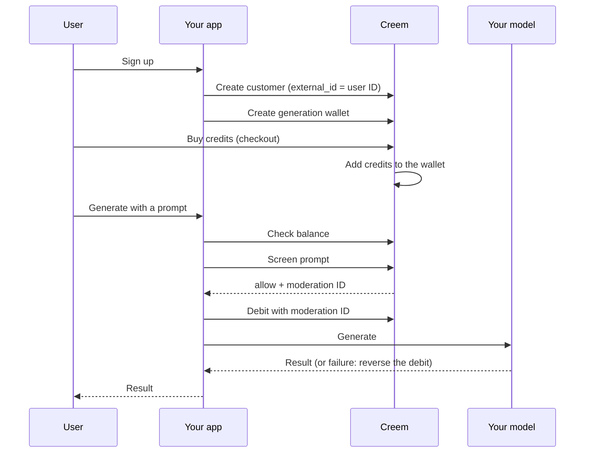

New to the Gen AI requirements? Start with [Gen AI Requirements](/merchant-of-record/account-reviews/gen-ai-requirements) to see why this integration is required.

## Before you start: your app runs on credits

The whole setup is built on one idea: **every user of your app has a credit balance**. Users buy credits, and every generation spends them. This applies whether your users top up through a subscription, a one time credit pack, or a usage based plan.

If your app doesn't work with a balance yet (credits, tokens, coins or any other unit), that is the first change to make. Everything in this guide builds on it.

With [Customer Credits](/features/customer-credits/introduction), Creem keeps that balance for you in a fully audited ledger. You credit, debit and read each user's balance through the API, without writing ledger code and without storing balances in your own database.

- **Purchases credit the balance automatically.** When a user buys a credit pack or a subscription renews, Creem adds the credits as part of the payment. You never apply purchased credits yourself, so you don't have to handle double crediting, retries, or failed webhooks.
- **You can still give credits yourself.** Free credits at signup, rewards or promotions are a single API call.
- **Every spend is linked to a screened prompt.** Each debit carries the ID of the [Moderation API](/features/moderation) result that cleared the prompt, so every generation can be traced back to a content check.

In this guide you learn how to read and write each user's credit wallet, and how to link a Moderation API call to every credit deduction.

## Key concepts

The integration connects five objects through their IDs:

| Object                    | ID              | What it is                                                                                                                   |
| ------------------------- | --------------- | ---------------------------------------------------------------------------------------------------------------------------- |
| **Customer**              | `cust_...`      | The Creem customer for one of your users. Its `external_id` is your own user ID.                                             |
| **Generation wallet**     | `cca_...`       | The user's credits account named `generation`. It holds the AI generation credits, and spending from it requires moderation. |
| **AI generation credits** | Product feature | A feature on your products. Every purchase or renewal of the product adds its credits to the buyer's generation wallet.      |
| **Moderation result**     | `id`            | The Moderation API's decision on one prompt: `allow`, `flag` or `deny`.                                                      |
| **Debit**                 | `cct_...`       | A credit spend from the generation wallet. It carries the moderation result ID that cleared the prompt.                      |

## How the flow works

In practice, the most common flow looks like this:

1. A user signs up on your app.
2. You create a Creem customer for that user, linked to your own user ID.
3. You create a generation wallet for that customer.
4. The user buys credits, through a subscription or a one time credit pack.
5. Creem adds the credits to the user's wallet automatically.
6. The user wants to generate content.
7. You check that the wallet has enough credits for the generation.
8. You screen the user's prompt with the Moderation API.
9. You debit the wallet, with the moderation result ID attached.
10. You generate the content, and reverse the debit if the generation fails.



The steps below walk through each part of the flow.

## Step 0: Set up the SDK

Install the [TypeScript SDK](/code/sdks/typescript), version 1.14.0 or later, and create one client. Your API key decides the environment: keys that start with `creem_test_` use the sandbox, live keys use production.

```bash
npm install creem
```

```typescript lib/creem.ts
import { Creem } from "creem";

const apiKey = process.env.CREEM_API_KEY!;

export const creem = new Creem({
  apiKey,
  // creem_test_ keys use the sandbox, live keys use production
  server: apiKey.startsWith("creem_test_") ? "test" : "prod",
});
```

## Step 1: Create a Creem customer for each user

When a user signs up, or the first time they open your generator, create a Creem customer and set `external_id` to your own user ID. This links the Creem customer, and the wallet you create next, to your user.

<CodeGroup>

```typescript TypeScript
const customer = await creem.customers.create({
  email: user.email,
  name: user.name,
  externalId: user.id, // your own user ID
});

await db.users.update(user.id, { creemCustomerId: customer.id }); // cust_...
```

```bash API
curl -X POST https://api.creem.io/v1/customers \
  -H "x-api-key: $CREEM_API_KEY" \
  -H "Content-Type: application/json" \
  -d '{
    "email": "jane@example.com",
    "name": "Jane Doe",
    "external_id": "user_123"
  }'
```

</CodeGroup>

## Step 2: Create the user's generation wallet

Create a credits account named `generation` for the customer. This name makes it the AI generation wallet: every purchase of AI generation credits lands in it, and every spend from it requires a moderation result ID.

<CodeGroup>

```typescript TypeScript
const wallet = await creem.customerCredits.createAccount({
  customerId: customer.id, // cust_...
  name: "generation", // makes this the moderated AI generation wallet
  unitLabel: "credits",
  initialBalance: "20", // optional free credits
});

await db.users.update(user.id, { creditAccountId: wallet.id }); // cca_...
```

```bash API
curl -X POST https://api.creem.io/v1/customer-credits/accounts \
  -H "x-api-key: $CREEM_API_KEY" \
  -H "Content-Type: application/json" \
  -d '{
    "customer_id": "cust_...",
    "name": "generation",
    "unit_label": "credits",
    "initial_balance": "20"
  }'
```

</CodeGroup>

<Tip>
  This step is optional: the user's first purchase creates the wallet for you. Creating it up front
  lets you store the wallet ID right away and give free credits before the first purchase.
</Tip>

<Note>
  Free credits work like paid ones. Spending them still requires a moderation result ID, and Creem
  refuses the debit without one.
</Note>

## Step 3: Sell credits with AI generation credits

Add **AI generation credits** to every product that sells credits for generations: credit packs and subscription plans. When a user pays, Creem adds the product's credits to their generation wallet as part of the payment. Subscriptions add them again on every renewal.

You don't need the API for this step. You can create the product in the dashboard instead, or use the API if you manage products in code.

<Tabs>
  <Tab title="Dashboard">
    1. Create a new product, or open an existing one, in **Products**.
    2. In **Delivery**, click **Add** and choose **New AI generation credits**.

    <Frame caption="Add AI generation credits as a delivery on the product.">
      
    </Frame>

    3. Fill in the **Description**, the **Credit amount** each purchase grants, and the **Unit label**.
    4. For subscriptions, choose whether **Unused credits reset each billing period**. When it's off, unused credits carry over to the next period.
    5. Set the pricing (one time for credit packs, subscription for plans) and save the product.

    <Frame caption="The AI generation credits delivery on a monthly subscription.">
      
    </Frame>

  </Tab>
  <Tab title="API">

```bash
curl -X POST https://api.creem.io/v1/products \
  -H "x-api-key: $CREEM_API_KEY" \
  -H "Content-Type: application/json" \
  -d '{
    "name": "500 credits",
    "description": "500 image and video credits",
    "price": 900,
    "currency": "USD",
    "billing_type": "onetime",
    "features": [
      {
        "type": "customerCredits",
        "description": "500 credits",
        "customer_credits": {
          "amount": "500",
          "unit_label": "credits",
          "requires_moderation": true
        }
      }
    ]
  }'
```

  </Tab>
</Tabs>

In the API, `requires_moderation: true` is what makes these AI generation credits. For subscription plans, add `"resets_each_period": true` to expire unused credits at each renewal instead of carrying them over.

## Step 4: Let users buy credits

Start the checkout with the customer from Step 1, so the credits land in that user's wallet.

<CodeGroup>

```typescript TypeScript
const checkout = await creem.checkouts.create({
  productId: PACK_500_PRODUCT_ID,
  customer: { id: user.creemCustomerId }, // the customer from Step 1
  successUrl: `${APP_URL}/success`,
  metadata: { referenceId: user.id },
});

return redirect(checkout.checkoutUrl!);
```

```bash API
curl -X POST https://api.creem.io/v1/checkouts \
  -H "x-api-key: $CREEM_API_KEY" \
  -H "Content-Type: application/json" \
  -d '{
    "product_id": "prod_...",
    "customer": { "id": "cust_..." },
    "success_url": "https://yourapp.com/success"
  }'
```

</CodeGroup>

When the payment succeeds, Creem adds the credits to the wallet. There is no credit call to write and no webhook to handle.

<Warning>
  Don't also add credits from a webhook such as `checkout.completed` or `subscription.paid`. Creem
  already adds them, so your users would get the credits twice. To refresh the balance in your UI,
  listen for the `credits.granted` webhook instead.
</Warning>

## Step 5: Check the balance before generating

Before you screen and generate, check that the wallet has enough credits for the generation, so you can show the user a clear message early.

<CodeGroup>

```typescript TypeScript
const { balance } = await creem.customerCredits.getAccountBalance(user.creditAccountId);

if (Number(balance) < cost) {
  return needCredits(cost); // ask the user to buy more credits
}
```

```bash API
curl https://api.creem.io/v1/customer-credits/accounts/cca_.../balance \
  -H "x-api-key: $CREEM_API_KEY"
```

</CodeGroup>

<Info>
  This check is for your user experience. The debit in Step 7 is what actually protects the balance:
  if the balance is too low at that moment, it fails with `insufficient_balance` and nothing is
  taken.
</Info>

## Step 6: Screen the prompt

Screen the prompt before anything else reaches your model: before you queue, debit or generate. Pass an `external_id` that ties the call to your user and the generation.

<CodeGroup>

```typescript TypeScript
let mod;
try {
  mod = await creem.moderation.screenPrompt(
    { prompt, externalId: `user_${user.id}:gen_${genId}` },
    { timeoutMs: 5000 },
  );
} catch {
  return block("moderation_unavailable"); // fail closed
}

if (mod.decision !== "allow") {
  return block(mod.decision); // "deny" and "flag" both stop here
}
```

```bash API
curl -X POST https://api.creem.io/v1/moderation/prompt \
  -H "x-api-key: $CREEM_API_KEY" \
  -H "Content-Type: application/json" \
  -d '{
    "prompt": "a watercolor fox in a snowy forest",
    "external_id": "user_123:gen_456"
  }'
```

</CodeGroup>

- **Only `allow` goes through.** `deny` is a block.
- **Treat `flag` as a block too.** Screen again, or stop.
- **Fail closed.** If the call errors or times out, don't generate.

See the [Moderation API](/features/moderation) for the full response and pricing.

## Step 7: Debit the wallet with the moderation ID

Debit the generation wallet and attach the moderation result ID from Step 6 as `moderation_id`. Without a valid one, Creem refuses the debit and nothing is taken.

<CodeGroup>

```typescript TypeScript
import { CustomerCreditsErrorResponseDto } from "creem/models/errors";

let debit;
try {
  debit = await creem.customerCredits.debitAccount(user.creditAccountId, {
    amount: String(cost), // for example 5 per image, 40 per video
    reference: `gen:${genId}`,
    idempotencyKey: `debit_${genId}`, // one key per generation
    moderationId: mod.id, // required on the generation wallet
  });
} catch (err) {
  if (err instanceof CustomerCreditsErrorResponseDto && err.error.code === "insufficient_balance") {
    return needCredits(cost); // nothing was debited
  }
  throw err; // moderation_* errors: screen again or stop. Nothing was debited.
}
```

```bash API
curl -X POST https://api.creem.io/v1/customer-credits/accounts/cca_.../debit \
  -H "x-api-key: $CREEM_API_KEY" \
  -H "Content-Type: application/json" \
  -d '{
    "amount": "5",
    "reference": "gen:gen_456",
    "idempotency_key": "debit_gen_456",
    "moderation_id": "<moderation result id>"
  }'
```

</CodeGroup>

- **One moderation ID pays for one debit.** If one prompt produces four images, debit all four in one call.
- **The moderation result must be recent.** It must be an `allow` decision from your store, at most 24 hours old.
- **Use one idempotency key per generation**, so a retry or a double click never charges twice.

## Step 8: Generate, then return or reverse

Call your model. If it succeeds, return the result. If it fails after you debited, reverse that exact debit so the user keeps their credits. The wallet history shows both the debit and the reversal.

```typescript TypeScript
try {
  const result = await model.generate({ prompt, mediaType });
  return ok(result);
} catch (err) {
  // the model failed after the debit: give the credits back
  try {
    await creem.customerCredits.reverseTransaction(user.creditAccountId, {
      transactionId: debit.id, // cct_..., reversals are idempotent
    });
  } catch {
    await flagForReconciliation(genId); // don't claim a refund that didn't happen
    return failed("Generation failed. We'll refund your credits shortly.");
  }
  return failed("Generation failed, your credits were refunded.");
}
```

<Tip>
  Prefer to debit after a successful generation? That works too, as long as the debit carries the
  moderation ID and happens within 24 hours of the screen. If the user retries after a reversal,
  screen the prompt again: each moderation ID can be used once.
</Tip>
